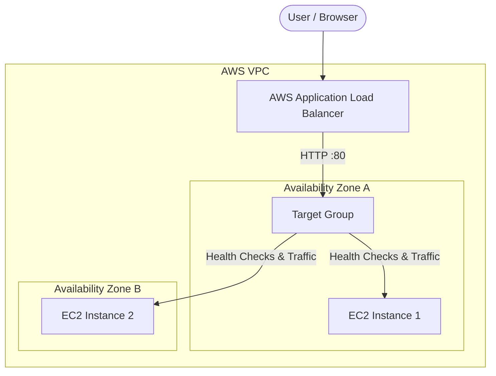
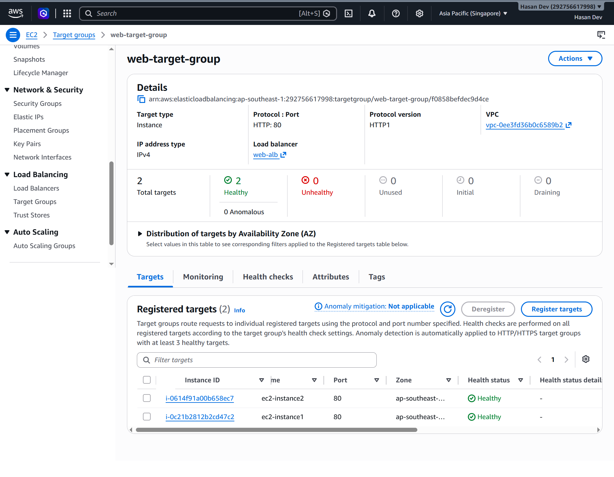
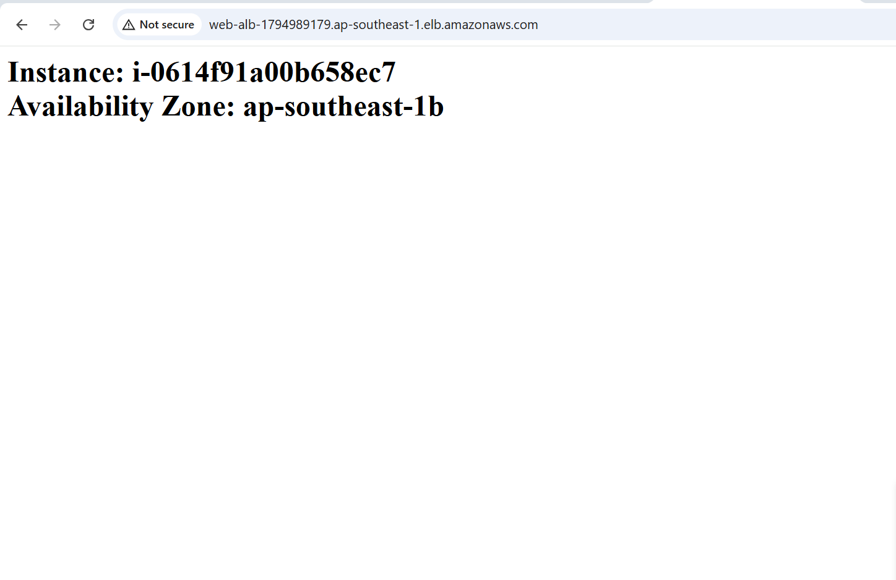
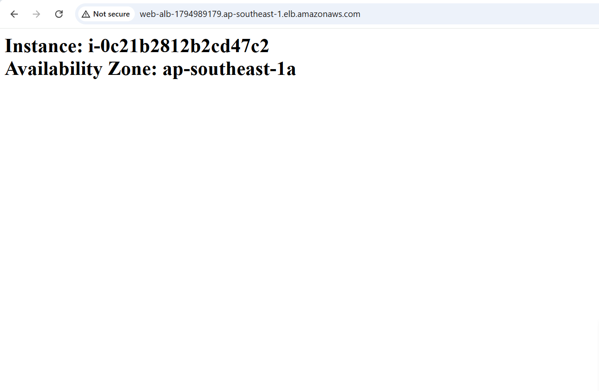
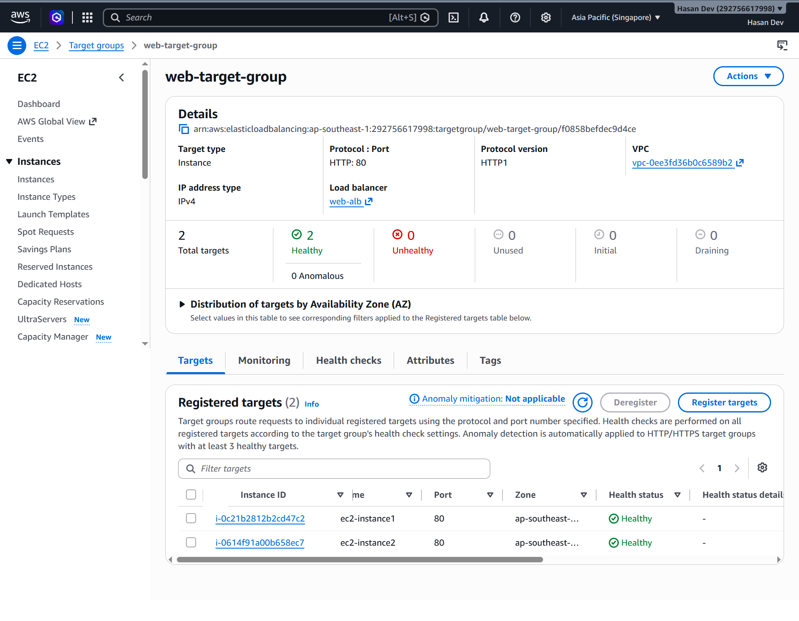
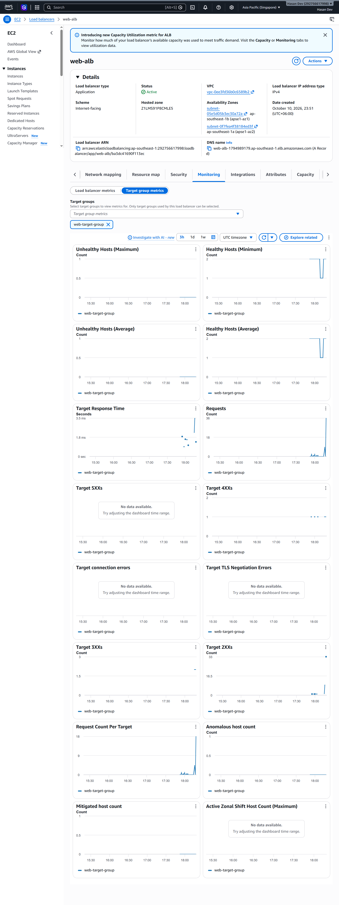

# High-Availability Web Service with Load Balancing

**Name:** Md Hasan Ali
**Option Chosen:** Option A – AWS Application Load Balancer

---

## Problem 1 – Architecture Design

### Architecture Diagram

### Component Description
*   **VPC:** We used the Default AWS VPC for simplicity, which spans multiple AZs.
*   **Subnets & AZs:** We used two subnets in two different Availability Zones (e.g., `us-east-1a` and `us-east-1b`) to ensure high availability.
*   **Security Groups:**
    *   **ALB Security Group:** Allows inbound HTTP (port 80) traffic from anywhere (`0.0.0.0/0`).
    *   **EC2 Security Group:** Allows inbound HTTP (port 80) traffic *only* from the ALB Security Group (to prevent direct access) and SSH (optional, for debugging).
*   **Application Load Balancer (ALB):** Distributes incoming user traffic across the healthy EC2 instances in different AZs.
*   **Target Group & Health Checks:** Monitors the `/health.html` endpoint. If an instance fails, the target group marks it unhealthy and ALB stops sending traffic to it.
*   **EC2 Instances:** Two Amazon Linux web servers running a Node.js (Express) app. They serve an index route showing their AZ name and a `/health.html` endpoint returning HTTP 200 OK.

---

## Setup Instructions (Two Methods)

You can build this infrastructure either **manually via the AWS Console** OR automatically using **Terraform** (both options are provided below).

### Method 1: Manual AWS Console Steps

**Problem 2 - Build Two Instances:**
1. Go to EC2 Dashboard -> Launch Instances.
2. Select Amazon Linux 2023 AMI, `t2.micro` instance type.
3. Network Settings: Select Default VPC. Choose Subnet in AZ `us-east-1a`.
4. Create a Security Group allowing HTTP from anywhere.
5. In Advanced Details -> User Data, paste the startup script (see `terraform/userdata.sh` in this repo).
6. Launch Instance 1.
7. Repeat the steps to launch Instance 2, but this time select a Subnet in AZ `us-east-1b`.

**Problem 3 - Configure Load Balancer:**
1. Go to Target Groups -> Create Target Group. Target type: Instances. Protocol: HTTP, Port: 80.
2. In Health Checks: Path `/health.html`.
3. Register the two EC2 instances as targets.
4. Go to Load Balancers -> Create Application Load Balancer.
5. Scheme: Internet-facing. Select the Default VPC and both AZs (`us-east-1a`, `us-east-1b`).
6. Security Group: Create or select the one allowing HTTP on port 80.
7. Listener: Port 80, Default action: Forward to the Target Group created earlier.
8. Create ALB.

### Method 2: Terraform (Infrastructure as Code)

1. Navigate to the `terraform/` folder in this repository.
2. Ensure you have AWS credentials configured locally (`aws configure`).
3. Run `terraform init` to initialize the project.
4. Run `terraform plan` to see the planned resources.
5. Run `terraform apply -auto-approve` to create the infrastructure.
6. The output will display the ALB DNS name.
7. *After testing, run `terraform destroy -auto-approve` to delete everything and avoid charges.*

---

## Problem 4 – Health Checks Implementation

*   **Path:** `/health.html`
*   **Interval:** 30 seconds (Checks the instance every 30s)
*   **Timeout:** 5 seconds (If no response in 5s, the check fails)
*   **Healthy Threshold:** 2 (Needs 2 consecutive successes to be marked healthy)
*   **Unhealthy Threshold:** 2 (Needs 2 consecutive failures to be marked unhealthy)
*   **Justification:** These values provide a good balance. A 30s interval ensures we don't overload the server with checks, but a threshold of 2 means we can detect a failure within 1 minute. It allows fast removal of failed instances and fast recovery.

**Active vs Passive Health Checks:**
*   **Active Health Checks:** The Load Balancer actively sends periodic requests (like a ping) to a specific endpoint (e.g., `/health.html`) to check the server status, even if there is no user traffic.
*   **Passive Health Checks:** The Load Balancer monitors real user traffic. If users get a certain number of errors (like 500 Internal Server Error) or timeouts, it marks the server as unhealthy.
*   **What AWS ALB uses:** AWS Application Load Balancer uses **Active Health Checks**. It proactively pings the configured path in the target group.

---

## Problem 5 – Failure Testing and Proof of Work

*(Replace these placeholder images with your actual screenshots)*

### T1 – Health status
**Expected:** Both instances healthy.

### T2 – Load distribution
**Expected:** Sending requests to the ALB shows responses coming from both instances.

### T3 – Browser test
**Expected:** Refreshing the ALB address in a browser changes the page between instances.

### T4 – AZ failure
**Expected:** Stopped AZ-A instance is marked unhealthy; all requests served by AZ-B.

### T5 – Recovery
**Expected:** Started AZ-A instance again; it becomes healthy and traffic is shared automatically.

### T6 – Logs / monitoring
**Expected:** Target metrics or ALB access logs showing requests reaching both instances.

### Optional - Terraform Proof
**Expected:** Terraform init, plan, apply, and destroy screenshots.

---

## Problem 6 – Reflection

**1. AWS ALB vs. NGINX - Advantages and Limitations:**
*   **AWS ALB:**
    *   *Advantages:* Fully managed service, built-in high availability across multiple AZs, out-of-the-box active health checks, integrates perfectly with AWS Auto Scaling and Security Groups, handles SSL termination easily.
    *   *Limitations:* Costs money, vendor lock-in to AWS, less flexible if you need deep, custom routing logic compared to raw Nginx configurations.
*   **NGINX (Open-source):**
    *   *Advantages:* Free, cloud-agnostic (can run anywhere - locally, AWS, GCP), extremely fast and customizable, can act as a web server and reverse proxy simultaneously.
    *   *Limitations:* You have to manage the server it runs on. It can become a Single Point of Failure (SPOF) if not configured in a clustered setup (like with Keepalived). Open-source version only supports passive health checks (active health checks require NGINX Plus).

**2. What if the Load Balancer fails? How is it handled in production?**
If a single Nginx load balancer fails, the entire application goes down because it is a Single Point of Failure (SPOF). In real production systems, this is solved by deploying load balancers in High Availability (HA) pairs. For example, two Nginx servers running with **Keepalived** sharing a Virtual IP (VIP). If the active LB fails, the standby LB instantly takes over the VIP. Managed services like AWS ALB handle this automatically under the hood by running multiple redundant nodes across AZs so we don't have to worry about it.

**3. One problem faced and solved:**
*Problem:* At first, the EC2 instances were accessible directly via their public IPs, which violates the security constraint.
*Solution:* I modified the EC2 Security Group rules. Instead of allowing HTTP traffic from `0.0.0.0/0`, I restricted the HTTP inbound rule to only accept traffic from the Security Group ID attached to the Application Load Balancer. This successfully forced all traffic to go through the Load Balancer.
